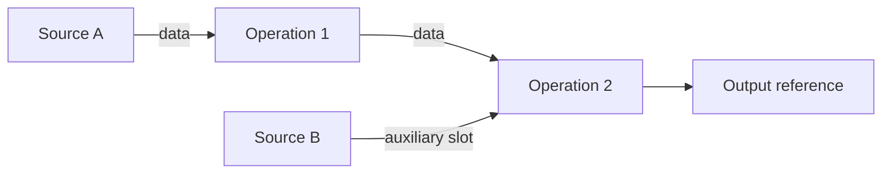

# Provenance contract and implementation plan

## Contract

Users must be able to understand an action from the visible data, recorded operations,
and source choices. Window ownership, open windows, caches, and retained checkpoints
must not silently change its meaning.

Preserve one complete source-to-result derivation graph in `ToolProvenanceSpec`.
Equivalent operations on equivalent sources must produce equivalent graphs and
behavior whether they come from a dialog, a pasted step, the console, or a tool output.
Execution, copied code, dependency status, and provenance display must use that graph.
A window displays an output; its placement does not select a source policy.

## Graph model

Schema 4 has three main fields: `nodes`, `output`, and an optional `input_ref` for a
fragment. A `ValueRef` identifies a node by its opaque ID. An operation stores a
primary `data` reference and references for its declared auxiliary input slots.
`output` selects the result explicitly.

Node types have separate purposes:

| Node | Definition |
| --- | --- |
| `FileSourceNode` | A path and a typed loader call, including data selection |
| `MemorySourceNode` | A stable identity owned independently of a window |
| `SnapshotSourceNode` | One explicit, fixed data revision |
| `OperationNode` | A typed operation and references to its input values |
| `CodeNode` | Python with declared input references and one local output |
| `InputNode` | The primary placeholder of a fragment before attachment |

Node labels are presentation metadata. They can be equal, changed, empty, or contain
text that is not a Python identifier. Labels and preferred Python output names never
identify graph edges. A code emitter assigns distinct Python names after the graph
is complete. Names inside a `CodeNode` belong to that node's local scope.

Each independent Python code node retains its own execution identity. Two equal code
blocks are not assumed to be deterministic. Reusing the same graph value is an
explicit shared dependency. Typed operations and equivalent file sources can share
values through their recorded definitions.

Validate unique node IDs, source definitions, references, operation slots, the output,
fragment placeholders, reachability, and absence of cycles. Revalidate copied graphs.
Keep this graph as the sole saved semantic representation. `ReplayGraph` is its
compiled execution plan. The revision store contains observed inputs and historical
checkpoints. Manager rows and windows are views of outputs.

## Source and execution rules

- Reload refreshes external sources and evaluates the recorded graph. Update uses
  current observed source revisions without requiring an external read. Historical
  replay uses exact recorded input revisions.
- A memory source owns its available data independently of its displaying window. It
  is a valid terminal input and has no external read to repeat.
- A fixed snapshot stays fixed during update and reload. Its fixed state must be
  visible. Producer history belongs to the revision record; it is not a fallback that
  can replace the snapshot's value.
- Resolve shared sources once per request. Closing a window cannot select a different
  producer recipe. Missing external sources report failure rather than silently using
  a checkpoint and reporting a successful reload.
- Replacement preserves the previous output as an upstream value before the window
  displays the new output. Detaching a window reference does not freeze the source.
- Record the recipe and input revisions used by each evaluation. Publish only after
  required inputs complete and recipe and source versions are still current. Failed
  or cancelled evaluation preserves the previous result.
- Acquisition updates must keep slicing responsive as the scan grid grows. Filters,
  deferred fits, and publication must preserve compatible cursor and view state.

## Compatibility

Existing schema-3 authoring and UI execution remain active until stage 3. The parser
continues to import older supported saved formats through the existing boundary.
Adding graph support must preserve schema-3 serialization and runtime behavior.

Use an explicit adapter for supported legacy recipes. Typed file and named-input
recipes become graph edges. Relative source views require an explicit parent and
apply their transforms once. Fixed legacy captures remain snapshot sources. A legacy
window-only input needs an explicitly supplied owned source; its window ID is not a
new memory-source identity.

Opaque legacy Python and replay contexts need an explicit conversion contract. The
initial adapter rejects them rather than guessing edges or freezing computed values.
New bounded Python uses `CodeNode` and retains stored-code trust checks. Failed graph
compilation still inventories stored executable content.

Old saved records cannot reliably distinguish deliberate snapshots from automatic
replacement captures. Preserve them as visible fixed inputs during UI migration and
provide an explicit conversion to their recorded producer where possible. Keep unused
legacy fallbacks lazy on the existing execution path.

## Four stages

Use `dev-provenance-redesign` as the integration branch. Each stage has its own PR
against that branch. After review and merge there, start the next stage from the
updated integration branch. After all four stages pass validation, open one final PR
to `main` and squash it for one provenance redesign entry on `main`.

### Stage 1: Concrete graph foundation

Status: implemented; awaiting review and merge into the integration branch.

Enhance `ToolProvenanceSpec` with schema-4 source and operation nodes, typed value
references, and an explicit output. Build and attach graphs through the same pure
construction path. Compile their references directly into the existing execution
engine. Keep code emission separate from dependency selection.

Preserve the operation catalog, file loading, revision storage, and trust mechanisms.
Keep existing UI actions, workspace ownership, reload policy, and legacy compiler
paths unchanged. Schema 3 remains the default for existing authoring. This stage
provides an opt-in graph foundation, not the user-facing behavior switch.

Completion criteria:

- Append and fragment attachment produce equivalent graph structure and results.
- Renaming labels and choosing preferred output names cannot change execution.
- File, memory, and snapshot sources resolve by their definitions or identities.
- Direct execution and executable copied code preserve primary and auxiliary inputs,
  including duplicate labels and shared inputs to mutating Python blocks.
- Python nodes retain trust checks and separate execution identities.
- JSON round trips preserve graph references and source choices. Invalid, ambiguous,
  or cyclic graphs fail validation.
- Explicit legacy adaptation preserves supported typed dependencies, fixed snapshots,
  and source transforms. Existing schema-3 serialization remains unchanged.
- Existing provenance, Manager, and workspace regressions pass under both Qt bindings.

### Stage 2: Shared evaluation requests

Status: pending.

Build update, reload, and historical-replay requests on the concrete graph. Add source
providers and source-generation records for external, memory, and fixed sources.
Resolve durable producer identity independently of windows. Carry the request through
nested ImageTool and ToolWindow results and share source reads within a request.

Prepare candidate data and execution records before publication. Check generations,
handle cancellation, and integrate deferred tool completion. Tool updates that mutate
widgets or start fits need a preparation and commit boundary. A context manager alone
does not make them transactional. Complete the required legacy conversion contracts
before the UI switches to the shared evaluator.

Completion criteria: test all three modes, mixed file and memory inputs, fixed
snapshots, shared sources, missing inputs, nested and deferred results, cancellation,
and source changes during evaluation. Current UI behavior remains unchanged.

### Stage 3: User action integration

Status: pending.

Route dialogs, paste, replacement, console results, child creation, and tool outputs
through graph construction and evaluation. Derive dependency status, provenance
display, and copied code from the same graph. Show source choices, migrate old captures
visibly, and update user documentation when the behavior contract changes.

Completion criteria: equivalent action paths have equivalent graphs and reload
results. Verify disk-only updates, changed auxiliary inputs, closed windows, workspace
round trips, growing scan dimensions, filters, and uninterrupted slicing. Reload does
not accumulate a transformation. Historical restoration remains exact. Fixed input
choices also survive full-code emission. Validate Qt-facing paths under both bindings.

### Stage 4: Legacy removal

Status: pending.

Remove superseded authoring and execution decisions after all callers use the shared
path. Retain compatibility import for supported saved formats at the parser boundary.
Remove duplicate source-policy flags and caches when their replacements cover every
caller.

Completion criteria: one graph-construction and source-resolution path remains.
Compatibility fixtures, the framework regression matrix, and repository checks pass.

## Validation and handoff

Follow `AGENTS.md` and its task instructions. Reuse passing checks while their code is
unchanged. Record checked behavior and material limitations before each stage PR.
Keep performance claims tied to measurements and retain unresolved limitations here.

Stage 1 now uses the concrete graph instead of wrappers around name-based recipes.
Its direct compiler does not enter the legacy mutable-name binding loop. Schema-3
compatibility remains a separate import path until integration. The initial explicit
adapter deliberately rejects opaque legacy Python and legacy execution contexts.

Stage 1 validation:

- The 55 concrete-graph tests pass under PyQt6 and PySide6. They cover label and
  preferred-name collisions, execution and copied code, scoped Python, source kinds,
  cache behavior, graph attachment, JSON round trips, and invalid graph structure.
- The existing provenance and replay-graph modules and five affected Manager shift
  tests pass under both bindings. Together with the new tests: 957 tests per binding.
- Workspace revision-store tests pass under both bindings: 161 tests per binding.
- Ruff formatting and lint checks, the CI partition check, and `git diff --check`
  pass. Mypy passes for all 333 source files in the complete Python 3.13 environment.
- `uv run --directory docs make html` passes with the changed model docstrings.
- Current UI actions continue to author schema 3. They have not switched to the new
  graph or the planned shared evaluation requests.

Remaining integration limits: the explicit adapter rejects opaque legacy Python and
legacy execution contexts. Legacy parsed-index file selections execute through typed
runtime loading but need a semantic selection before direct full-code emission.
Source-generation checks and UI/workspace graph ownership remain in stages 2 and 3.
